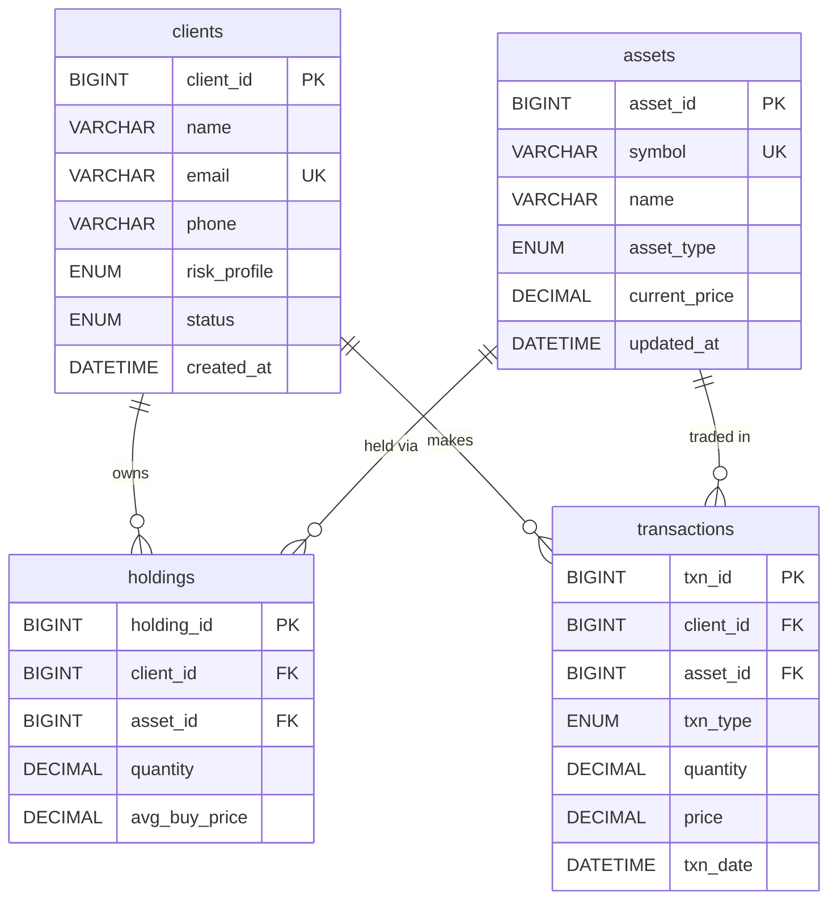

# Investment Portfolio Tracker

A production-style REST API for tracking investment portfolios, built with Java 17, Spring Boot 3, plain JDBC, and MySQL 8. Designed as a fresher interview project — clean, well-commented, and easy to explain.

---

## Tech Stack

| Layer        | Technology                          |
|--------------|-------------------------------------|
| Language     | Java 17                             |
| Framework    | Spring Boot 3.2                     |
| Build        | Maven                               |
| Database     | MySQL 8                             |
| Data Layer   | JDBC (PreparedStatement-based DAOs) |
| Conn. Pool   | HikariCP                            |
| Validation   | Bean Validation (Hibernate)         |
| Testing      | JUnit 5 + Mockito + H2              |

---

## ER Diagram (Mermaid)



---

## Project Structure

```
src/
├── main/
│   ├── java/com/portfolio/tracker/
│   │   ├── InvestmentPortfolioTrackerApplication.java
│   │   ├── config/         DataSourceConfig.java
│   │   ├── model/          Client, Asset, Stock, Bond, MutualFund, Holding, Transaction
│   │   │   └── enums/      TxnType, RiskProfile, AssetType, ClientStatus
│   │   ├── dao/            ClientDao, AssetDao, HoldingDao, TransactionDao (interfaces)
│   │   │   └── impl/       JDBC implementations
│   │   ├── service/        PortfolioService, TransactionService
│   │   ├── controller/     ClientController, AssetController,
│   │   │                   TransactionController, PortfolioController
│   │   ├── dto/            ClientRequestDto, TransactionRequestDto, UpdatePriceDto,
│   │   │                   PortfolioRowDto, ClientSummaryDto
│   │   └── exception/      Custom exceptions + GlobalExceptionHandler
│   └── resources/
│       ├── application.properties
│       ├── schema.sql
│       ├── data.sql
│       ├── views.sql
│       ├── procedures.sql
│       └── queries.sql
└── test/
    ├── java/com/portfolio/tracker/
    │   ├── service/        PortfolioServiceTest, TransactionServiceTest
    │   └── dao/            ClientDaoImplTest, TransactionDaoImplTest
    └── resources/
        ├── application.properties
        └── test-schema.sql
```

---

## Setup Steps

### 1. Prerequisites
- JDK 17+
- Maven 3.8+
- MySQL 8 running locally

### 2. Create the database and tables

```sql
-- Run in MySQL shell or any client (DBeaver, MySQL Workbench):
source src/main/resources/schema.sql
source src/main/resources/data.sql
source src/main/resources/views.sql
source src/main/resources/procedures.sql
```

### 3. Configure credentials

Edit `src/main/resources/application.properties`:

```properties
spring.datasource.url=jdbc:mysql://localhost:3306/portfolio_db?useSSL=false&serverTimezone=UTC
spring.datasource.username=YOUR_USERNAME
spring.datasource.password=YOUR_PASSWORD
```

### 4. Build and run

```bash
# From the project root (where pom.xml lives):
mvn clean package -DskipTests
java -jar target/investment-portfolio-tracker-1.0.0-SNAPSHOT.jar
```

Or run directly from Maven:

```bash
mvn spring-boot:run
```

The app starts on **http://localhost:8080**.

### 5. Run tests

```bash
mvn test
```

Tests use H2 in-memory database — no MySQL connection needed.

---

## Sample API Requests (curl)

### Create a client
```bash
curl -X POST http://localhost:8080/api/clients \
  -H "Content-Type: application/json" \
  -d '{
    "name": "Arjun Sharma",
    "email": "arjun@example.com",
    "phone": "9876543210",
    "riskProfile": "AGGRESSIVE"
  }'
```

### Get all clients
```bash
curl http://localhost:8080/api/clients
```

### Get a client's portfolio
```bash
curl http://localhost:8080/api/clients/1/portfolio
```

### Get a client's summary (P&L)
```bash
curl http://localhost:8080/api/clients/1/summary
```

### Place a BUY order
```bash
curl -X POST http://localhost:8080/api/transactions \
  -H "Content-Type: application/json" \
  -d '{
    "clientId": 1,
    "assetId": 1,
    "txnType": "BUY",
    "quantity": 5,
    "price": 190.00
  }'
```

### Place a SELL order
```bash
curl -X POST http://localhost:8080/api/transactions \
  -H "Content-Type: application/json" \
  -d '{
    "clientId": 1,
    "assetId": 1,
    "txnType": "SELL",
    "quantity": 2,
    "price": 195.00
  }'
```

### Get transaction history (filtered)
```bash
curl "http://localhost:8080/api/transactions?clientId=1&type=BUY&from=2024-01-01T00:00:00"
```

### Get all assets
```bash
curl http://localhost:8080/api/assets
```

### Update an asset's price
```bash
curl -X PUT http://localhost:8080/api/assets/1/price \
  -H "Content-Type: application/json" \
  -d '{"price": 200.00}'
```

### Deactivate a client (soft-delete)
```bash
curl -X DELETE http://localhost:8080/api/clients/5
```

---

## Design Decisions & Trade-offs

### Why JDBC instead of JPA/Hibernate?
JDBC gives you full visibility into the SQL being executed. For a portfolio system where correctness of financial calculations matters, seeing the exact query is important. JPA adds magic (lazy loading, caching, N+1 problems) that can mask bugs. JDBC also demonstrates you understand how data access actually works, which interviewers value.

**Trade-off:** More boilerplate code (mapRow helpers, try-with-resources blocks). JPA would be faster to write for a large schema.

### Why HikariCP?
Opening a new TCP connection to MySQL for every request is expensive (~50ms). HikariCP maintains a pool of pre-opened connections and lends them out per request. It's Spring Boot's default for good reason — it's the fastest Java connection pool available.

### Why the Connection is passed between DAOs in a transaction?
A BUY must atomically insert into `transactions` AND update `holdings`. If we use two separate connections, a crash between the two operations would leave the data inconsistent. Sharing one connection with `setAutoCommit(false)` gives us ACID guarantees — either both succeed (commit) or both are undone (rollback).

### Why soft-delete for clients?
Transactions reference `client_id` as a foreign key. If we hard-deleted a client, we'd have to also delete their transaction history (which violates audit trail requirements) or set FK to NULL (which loses the reference). Soft-delete (setting `status = INACTIVE`) preserves all history.

### Why DTOs instead of using domain models in controllers directly?
Domain models can have fields that shouldn't be exposed to the API (e.g., internal IDs, timestamps set by the DB). DTOs also decouple the API contract from the DB schema — you can change the table without breaking clients, and vice versa.

### Three-layer validation strategy
| Layer | What | Where |
|-------|------|-------|
| 1 | Format/type checks (@NotBlank, @Positive) | DTO + Bean Validation |
| 2 | Business rules (active client, sufficient holdings) | Service layer |
| 3 | Database constraints (CHECK, trigger) | MySQL schema + procedures.sql |

This defense-in-depth means even if the API is bypassed (e.g., direct DB access), data integrity is still enforced.

---

## 8 Likely Interview Questions & Answers

**Q1: What is a JDBC transaction and why did you use it here?**
A: A JDBC transaction is a unit of work where multiple SQL operations either all succeed or all fail together. I use it in `processTransaction()` because a BUY/SELL involves inserting into `transactions` AND updating `holdings`. Without a transaction, a server crash between the two would leave inconsistent data — a transaction recorded but holdings not updated. I call `setAutoCommit(false)`, then `commit()` on success and `rollback()` on failure.

**Q2: What is the weighted average buy price formula and where do you calculate it?**
A: `newAvg = (oldQty * oldAvg + buyQty * buyPrice) / (oldQty + buyQty)`. It lives in `TransactionService.processBuy()`. For example, if you hold 10 shares @ $150 and buy 5 more @ $160, the new average is (10×150 + 5×160) / 15 = $153.33. This is correct cost-basis accounting.

**Q3: Why does HoldingDao.findByClientAndAsset() accept a Connection parameter?**
A: Because it's called from within a JDBC transaction managed by `TransactionService`. If it opened its own connection, it would be on a different transaction and changes made there wouldn't be visible until committed. By accepting the caller's connection, both the read and the subsequent insert/update happen in the same transaction.

**Q4: What's the difference between INNER JOIN and LEFT JOIN, and where did you use each?**
A: INNER JOIN returns only rows that have matches in both tables. LEFT JOIN returns all rows from the left table plus matching rows from the right (NULLs for no match). In `vw_client_summary` I use LEFT JOIN between clients and holdings so clients with zero holdings still appear in the summary view. In `vw_client_portfolio` I use INNER JOIN because a row only makes sense if both a holding and an asset exist.

**Q5: Why is the trigger trg_before_sell in the database when the service already checks?**
A: Defense-in-depth. The service check (Layer 2) can fail if someone bypasses the REST API and runs SQL directly against the database. The trigger (Layer 3) is the final line of defense. It uses `SIGNAL SQLSTATE '45000'` which is MySQL's way of throwing a user-defined error from a trigger.

**Q6: What OOP principles did you apply?**
A: Encapsulation — all model fields are private with getters/setters. Abstraction — DAO interfaces separate what from how. Inheritance/Polymorphism — Stock, Bond, MutualFund extend Asset and override `getPricingDescription()`. Dependency Injection — services receive DAOs through constructors, not by creating them with `new`. Single Responsibility — `PortfolioService` handles reads, `TransactionService` handles writes.

**Q7: How would you scale this if traffic grew 100×?**
A: First, increase the HikariCP pool size. Add a read replica for reporting queries (portfolio/summary are read-heavy). Add Redis caching for asset prices since they change infrequently. Move to async transaction processing with a message queue (Kafka) for high-volume BUY/SELL. Index `txn_date` and FK columns — already done in schema.sql.

**Q8: What would you add if you had more time?**
A: JWT authentication and authorization (clients can only see their own portfolio). Pagination on the transaction history endpoint. An async price-refresh job that pulls live prices from a market data API. Spring Boot Actuator for health/metrics endpoints. A proper audit log table. Integration tests with Testcontainers (using a real MySQL container instead of H2).
